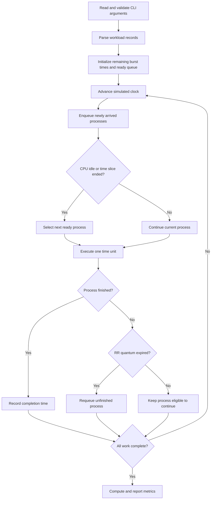
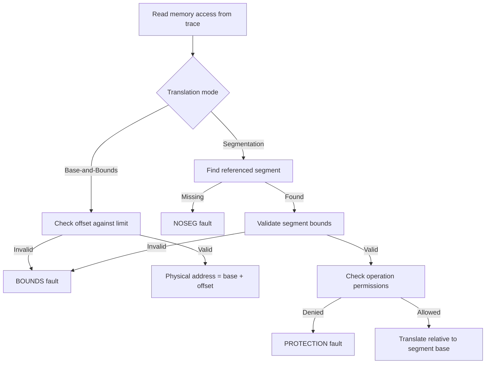

<div align="center">

# OS Scheduling & Memory Simulators

**Discrete-time CPU scheduling and virtual-memory address translation, implemented in C**


*An exploration of how operating systems allocate CPU time, translate virtual addresses, enforce memory protection, and expose the performance consequences of scheduling decisions.*

</div>

---

## Overview

This repository contains two systems-programming projects developed for **CMPT 360 (Operating Systems)**. Both are written in C and built around explicit input parsing, deterministic simulation, and structured diagnostics. Rather than relying on OS internals as black boxes, the programs model scheduling and address-translation rules directly so their behavior can be inspected and tested.

| Component | Algorithms / mechanisms | Primary outputs |
|---|---|---|
| **CPU Scheduling Simulator (`A2/`)** | First-Come, First-Served (FCFS); Round Robin (RR) | Execution timeline; first-run and completion times; turnaround and response time; context-switch count |
| **Virtual Memory Simulator (`A3/`)** | Base-and-Bounds (BB); Segmentation (SEG) | Physical-address translations; bounds/protection/missing-segment faults; access statistics |

### Technical focus

- **State-machine simulation:** Track system state as events or memory accesses are processed.
- **Scheduling algorithms:** Compare FIFO/non-preemptive dispatch with time-quantum-based preemption.
- **Memory safety:** Check virtual-address bounds and segment access permissions before calculating physical addresses.
- **Low-level engineering:** Parse command-line parameters and structured inputs, validate invariants, manage memory, and report faults precisely.
- **Reproducibility:** Run predefined workloads and traces through the same executable paths to inspect deterministic output.

> **Scope:** These are educational simulators, not a production operating-system scheduler, emulator, or kernel module. The repository does not implement GPU visualization or actual concurrent execution; the CPU scheduler simulates process execution over discrete time.

---

## Repository structure

```text
OS-Scheduling-and-Memory-Simulators/
├── A2/                         # CPU scheduling simulator
│   ├── sched.c                  # Scheduler implementation
│   ├── sched.h                  # Scheduler declarations/types
│   ├── makefile                 # Build configuration
│   ├── README.md                # Assignment-specific details
│   ├── Workload_Samples/        # Sample scheduler workloads
│   └── Workload_Expected/       # Expected results for workloads
├── A3/                         # Virtual memory simulator
│   ├── vmsim.c                  # Address-translation implementation
│   ├── vmsim.h                  # Simulator declarations/types
│   ├── makefile                 # Build configuration
│   ├── README.md                # Assignment-specific details
│   ├── tests/                   # Test inputs / artifacts
│   └── Milestone_1_CLI_Test_Commands.txt
└── README.md                   # Repository overview (this file)
```

The tree above focuses on source and useful test assets rather than generated executables and assignment archives.

---

## Getting started

### Requirements

- A C11-capable compiler (for example, GCC or Clang)
- `make` (for the included makefiles)
- A Unix-like terminal for the examples below; Windows users can use WSL or an equivalent development environment
- Optional: **Valgrind** for checking heap-memory usage

### Clone and build

```bash
git clone https://github.com/amalali44/OS-Concurrency-and-visualization-scripts.git
cd OS-Concurrency-and-visualization-scripts

# Build the CPU scheduler
cd A2
make
cd ..

# Build the virtual memory simulator
cd A3
make
```

> If the repository has been renamed on GitHub, replace the clone URL and directory name accordingly. For exact build targets or executable naming on your platform, inspect each directory's `makefile`.

---

## 1. CPU scheduling simulator

**Location:** [`A2/`](./A2)  
**Source:** [`sched.c`](./A2/sched.c)

### Problem statement

A CPU scheduler determines which ready process receives processor time. Different policies trade off fairness, responsiveness, context-switch overhead, and completion time. The simulator accepts a workload describing process arrivals and CPU bursts, executes the selected policy over **one simulated CPU**, and computes per-process and aggregate execution information.

### Workload model

Each workload record contains:

| Field | Meaning | Constraint |
|---|---|---|
| `PID` | Process identifier | Nonnegative integer |
| `ARRIVAL` | Time at which the process becomes ready | Nonnegative integer |
| `CPU_TIME` | CPU burst duration | Positive integer |

The simulator advances in discrete time units. A process can run only after it arrives and becomes eligible for dispatch.

### Policies

#### First-Come, First-Served (FCFS)

FCFS selects the waiting process in arrival order. Once dispatched, a process runs until its CPU burst completes (no time-slice preemption in this model). It is simple and has little scheduling-policy overhead, but a long burst can delay shorter processes behind it—the **convoy effect**.

#### Round Robin (RR)

RR allocates at most a configurable quantum to the currently running process. If it does not finish, it returns to the ready queue and waits for another turn. RR improves opportunities for response among competing processes, but smaller quanta can increase context switches.

| Property | FCFS | Round Robin |
|---|---|---|
| Preemptive? | No | Yes, at quantum expiration |
| Ordering | Arrival/ready-queue order | Rotating ready queue |
| Configurable time quantum | No | Yes |
| Main trade-off | Simplicity vs. possible long waits | Responsiveness vs. switching overhead |

### Scheduling lifecycle



### CLI usage

The A2 README documents these command-line arguments:

```text
--policy=FCFS|RR    Scheduling policy
--in=FILENAME      Input workload path
--quantum=N        Required for RR
```

Examples (replace the input path with an existing workload from `A2/Workload_Samples/`):

```bash
cd A2

# First-Come, First-Served
./sched --policy=FCFS --in=Workload_Samples/<workload-file>

# Round Robin with a three-tick time slice
./sched --policy=RR --in=Workload_Samples/<workload-file> --quantum=3
```

> The executable name `sched` follows the source filename and documented command interface; if the makefile uses a different output target, use that target instead. The `<workload-file>` token is a placeholder, not a literal filename.

### Metrics and interpretation

For process \(i\), define arrival time \(a_i\), first dispatch time \(s_i\), completion time \(c_i\), and total CPU burst \(b_i\).

| Metric | Definition | Interpretation |
|---|---|---|
| **Response time** | \(s_i-a_i\) | Delay until first CPU service |
| **Turnaround time** | \(c_i-a_i\) | End-to-end time in the system |
| **Waiting time** | \((c_i-a_i)-b_i\) | Derived time not executing on the CPU |
| **Context switches** | Count of changes from one running process to another | Scheduling-switch activity |

The repository's documented output includes **first-run time, completion time, turnaround time, response time, context-switch count, and a timeline**. Waiting time is shown here as a derived metric for analysis; it is not claimed to be a directly emitted field.

For comparative experiments, use the same workload under FCFS and RR with several quantum values. Examine whether lower first-response delays come at the cost of more context switches or longer completion times.

---

## 2. Virtual memory address-translation simulator

**Location:** [`A3/`](./A3)  
**Source:** [`vmsim.c`](./A3/vmsim.c)

### Problem statement

A process generates **logical (virtual) addresses**, but memory accesses must resolve to allowable physical memory locations. The simulator models address translation and protection checks under two schemes: **Base-and-Bounds** and **Segmentation**. Each trace record describes a memory access, and the program either emits a physical address or reports why translation failed.

### Mode A: Base-and-Bounds (BB)

A process is assigned a contiguous region defined by a base address and a limit. For logical offset \(o\):

\[
\text{Valid}(o) \iff 0 \leq o < \text{limit}
\]

\[
\text{PhysicalAddress} = \text{base} + o
\]

An access outside the allowed range produces a **BOUNDS fault** rather than a physical address.

```text
Logical offset ──▶ Bounds check ──▶ Add base ──▶ Physical address
                        │
                        └── Invalid ──▶ BOUNDS fault
```

### Mode B: Segmentation (SEG)

Segmentation associates logical addresses with named regions containing a base address, extent, and permissions. The simulator looks up a segment and validates both the address and requested access operation before translating it.

Conceptual segment metadata:

| Attribute | Purpose |
|---|---|
| Segment name | Identifies the logical memory region |
| Base | Physical placement of the region |
| Limit | Allowed extent / bound |
| Permissions | Controls access by operation |

For ordinary segments, the documented rule is \(0 \leq o < \text{limit}\) and \(PA=\text{base}+o\). The assignment also models a **downward-growing stack** using a signed offset: \(o_{signed}=o-\text{limit}\), with \(PA=\text{base}+o_{signed}\) if the documented stack-bounds check succeeds.

### Translation pipeline



### Fault taxonomy

| Fault | Trigger | What it demonstrates |
|---|---|---|
| `BOUNDS` | Offset outside allocated region | Spatial memory protection |
| `PROTECTION` | Operation not permitted for the segment | Access-control enforcement |
| `NOSEG` | Referenced segment does not exist | Invalid segment reference |

The A3 README describes parsing trace records, validating configuration and operation formats, printing per-access outcomes, and summarizing successful translations and fault totals.

### CLI usage

The A3 README documents the following modes and required arguments:

```text
--mode=bb          Base-and-Bounds mode
--base=N           Physical base address (BB)
--limit=N          Address-space limit (BB)
--trace=FILE       Access trace

--mode=seg         Segmentation mode
--config=FILE      Segment configuration (SEG)
--trace=FILE       Access trace
```

Example command shapes:

```bash
cd A3

# Base-and-Bounds: concrete base/limit, substitute a real trace path
./vmsim --mode=bb --base=4096 --limit=1024 --trace=tests/<trace-file>

# Segmentation: substitute real configuration and trace paths
./vmsim --mode=seg --config=tests/<config-file> --trace=tests/<trace-file>
```

> Angle-bracketed filenames are placeholders. Check `A3/tests/` and `A3/Milestone_1_CLI_Test_Commands.txt` for the repository's actual test filenames and recorded invocations.

---

## Implementation design

### Separation of concerns

Although each simulator is compact, its source is organized around specific responsibilities:

| Module / function | Responsibility |
|---|---|
| `A2: parse_args()` | Validate scheduling policy, input path and RR quantum |
| `A2: load_workload()` | Parse processes and reject invalid workload records |
| `A2: simulate()` | Advance time, dispatch processes, maintain the ready queue and calculate metrics |
| `A2: main()` | Coordinate setup, simulation, reporting, and cleanup |
| `A3: parse_args()` | Validate translation mode and mode-specific CLI settings |
| `A3: run_bb()` | Check base-and-bounds accesses and record translations/faults |
| `A3: run_seg()` | Read segment definitions, check access bounds/permissions and translate |
| `A3: main()` | Coordinate the selected translation mode and statistics |

### Design considerations

**Deterministic inputs.** Workloads and trace files make it possible to reproduce exactly the same simulation conditions, compare outputs, and investigate edge cases.

**Validation before execution.** The parsers reject invalid arguments and malformed input rather than silently treating them as valid tasks or addresses.

**Explicit state.** The CPU scheduler records remaining work and timing information, while the memory simulator tracks addressing constraints and access outcomes; this makes algorithm behavior inspectable.

**Diagnostics as outputs.** A fault is a modeled result, not merely a crashed program. Fault type and per-access reporting show why a particular translation did not succeed.

---

## Testing and correctness

The original assignment READMEs report the following development checks:

- **A2:** FCFS and RR were tested with provided workload sets; compilation was reported warning-free with `-std=c11 -Wall -Wextra -pedantic`.
- **A3:** Both BB and SEG modes were reported functional and warning-free with the same compiler flags.
- **A2 and A3:** Valgrind results were reported as having no remaining heap allocations.
- **Known A3 limitation:** The A3 README notes that some malformed segment-configuration error cases/messages were not implemented at submission time.

These are **historical statements in the assignment documentation**, not a claim that automated CI has independently revalidated the current repository on every platform.

### Suggested local verification

```bash
# Compile from the supplied makefile targets
cd A2 && make
cd ../A3 && make

# Optional: run Valgrind with a known-valid invocation
# valgrind --leak-check=full ./sched ...
# valgrind --leak-check=full ./vmsim ...
```

A useful regression suite should cover:

| Area | Cases worth checking |
|---|---|
| Scheduler | Empty/invalid inputs, simultaneous arrivals, idle CPU periods, one process, RR quantum boundaries |
| Scheduler metrics | First service, completion order, turnaround and response calculations |
| BB memory | Zero offset, last valid offset, first invalid offset, malformed trace rows |
| Segmentation | Unknown segments, disallowed operations, boundary addresses, downward-growing stack cases |
| Resource safety | Successful allocations, error-path cleanup, leak checks |

These are **recommended checks**, not a claim that all tests are already implemented.

---

## Algorithmic complexity and trade-offs

The precise runtime depends on the data structures and accounting choices in the C implementations. The following are **conceptual bounds**, not instrumented benchmarks:

- **FCFS:** With a ready queue, dispatch can be constant time after arrivals are organized; a time-tick simulator still performs work proportional to the simulated execution timeline.
- **Round Robin:** Each quantum expiration may add a dispatch and queue operation. Smaller quanta tend to increase the number of dispatch events for a fixed workload.
- **Base-and-Bounds:** Given one parsed access and its base/limit, bounds validation plus address arithmetic are constant-time operations.
- **Segmentation:** Translation requires locating the referenced segment; linear search costs \(O(S)\) for \(S\) segments, while a suitable indexed structure can improve lookup. The documented repository does not establish a measured comparison between these alternatives.

### Why these trade-offs matter

A scheduler is judged not only by whether processes eventually finish, but by **latency, fairness, overhead, and response behavior**. Likewise, memory translation must combine address arithmetic with **correct protection semantics**, since a fast but unsafe translation is still incorrect. These simulations make those system-level trade-offs observable with small, controlled experiments.

---

## Limitations

- Simulates **one CPU**, not a multicore scheduler.
- CPU time advances discretely; the project is not intended to predict real processor latency or cache behavior.
- Does not model true simultaneous threads or synchronization primitives.
- Memory translation focuses on **Base-and-Bounds and Segmentation**, rather than page tables, TLBs, or demand paging.
- A3's original README documents incomplete handling of certain malformed configuration cases.
- No production performance or speedup figures are claimed here.

## Potential extensions

- Add **Shortest Job First**, **Shortest Remaining Time First**, and priority scheduling as comparative baselines.
- Generate CSV summaries and plots of response time, turnaround time, and context switches across quantum settings.
- Add configurable context-switch penalties to study policy overhead.
- Expand address translation with paging, multilevel page tables, and TLB hit/miss modeling.
- Integrate automated correctness tests and GitHub Actions CI.
- Add sanitizers and fuzz malformed workload/configuration inputs.

These are ideas for future development, **not implemented features**.

---

## Key takeaways

This project demonstrates hands-on understanding of **CPU scheduling, queue-based state transitions, virtual-to-physical address translation, memory protection, systems-level input validation, and C memory management**. It emphasizes rigorous reasoning about system state and fault conditions—skills that transfer to runtime engineering, infrastructure development, systems optimization, and performance-oriented software.

## Author

**Amal Ali**  
Computer Science — MacEwan University  
[GitHub](https://github.com/amalali44)

---

<sub>Educational systems-programming project. Refer to `A2/README.md` and `A3/README.md` for assignment-specific implementation notes.</sub>
